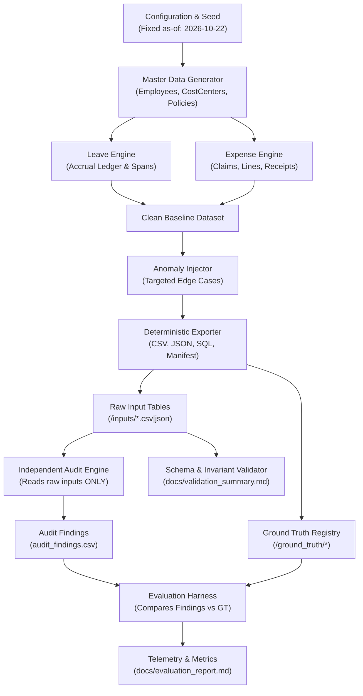

# YottaGen: Deterministic Synthetic Corporate Governance Data Generator & Audit Engine

[](https://www.python.org/)
[]()
[-brightgreen.svg)]()
[]()
[](LICENSE)

A complete, production-grade, reproducible synthetic data generator, invariant validator, independent rule audit engine, and evaluation harness. YottaGen models enterprise corporate governance: routing leave applications and business expense claims using company policy, ledger-backed accruals, departmental budgets, supervisory hierarchy, and tiered approval authority.

---

## 1. Architecture Overview

YottaGen is structured around a strict **Separation of Concerns** where generator, ground truth, and audit detector operate in complete isolation to guarantee zero data leakage:



---

## 2. Quick Start

### Prerequisites
- Python 3.10+ (Standard library only for generation and execution).
- `pytest` (Optional, for test automation).

### Installation & Execution
```bash
# 1. Clone or navigate to the repository
git clone <repo-url> yottagen
cd yottagen

# 2. (Optional) Create virtual environment
python -m venv .venv
# Windows:
.venv\Scripts\activate
# Linux/macOS:
source .venv/bin/activate

# 3. Install test dependencies
pip install -r requirements.txt

# 4. Run end-to-end pipeline (Starter, Full, Validate, Audit, Evaluate, Reproducibility)
# Cross-platform Python runner:
python make.py all

# Or via standard make:
make all
```

---

## 3. Directory & Artifact Structure

```text
.
├── Makefile                      # Standard build automation targets (generate, validate, audit, test, repro, all)
├── make.py                       # Cross-platform Python Makefile runner
├── requirements.txt              # Test dependencies (pytest>=8.0.0)
├── source_manifest.json          # Lawful provenance declaration (100% synthetic, zero external data)
├── AI_USAGE.md                   # AI acceleration disclosure, personal review and fixes
├── README.md                     # Comprehensive project documentation
├── prompts/
│   └── PROMPT_HISTORY.md         # Master submission prompt verbatim
├── docs/
│   ├── ERD.md                    # Mermaid ERD, cardinality matrix, and lifecycle state machines
│   ├── RULES.md                  # Comprehensive rule catalogue (LV-*, EX-*, AP-*, RB-*, CC-*)
│   ├── ASSUMPTIONS.md            # Documented modeling assumptions
│   ├── DECISIONS.md              # Architectural decisions (ledger math, split-claim detection, etc.)
│   ├── LIMITATIONS.md            # Documented boundaries and future roadmap
│   ├── data_dictionary.md        # Generated Markdown data dictionary
│   ├── data_dictionary.csv       # Generated CSV schema dictionary
│   ├── data_dictionary.json      # Generated JSON schema dictionary
│   ├── validation_summary.md     # Invariant validation report (Generated)
│   ├── validation_summary.json   # Machine-readable validation results (Generated)
│   ├── evaluation_report.md      # Precision, recall, F1, and operational KPIs (Generated)
│   ├── evaluation_report.json    # Machine-readable evaluation report (Generated)
│   └── reproducibility_report.md # File-by-file SHA-256 byte determinism report (Generated)
├── yottagen/                     # Core Python Package
│   ├── __init__.py               # Package metadata and version
│   ├── __main__.py               # python -m yottagen entrypoint
│   ├── config.py                 # Seeds, dates, exchange rates, and scale profiles
│   ├── schema.py                 # Single Source of Truth schema, DDL generator, and dictionaries
│   ├── ids.py                    # Canonical ID formatters and regex validators
│   ├── calendar.py               # Multi-country statutory holiday and business day engine
│   ├── master.py                 # Organizational hierarchy, employees, cost centers, policies
│   ├── leave.py                  # Month-by-month accrual ledger, requests, and workflows
│   ├── expense.py                # Expense claims, itemized lines, receipt metadata, and payments
│   ├── routing.py                # Tiered authority approval routing and self-approval prevention
│   ├── injector.py               # Labelled anomaly injector and ground-truth registry
│   ├── derive.py                 # Pure mathematical derivations (balances, totals, reimbursements)
│   ├── audit.py                  # Independent rule detector (reads raw inputs ONLY)
│   ├── validate.py               # Relational, arithmetic, and lifecycle invariant validator
│   ├── evaluate.py               # Evaluator comparing audit findings against ground truth
│   ├── repro.py                  # Multi-seed reproducibility verification engine
│   ├── export.py                 # Multi-format exporter (CSV, JSON, SQL DDL, seed, manifest)
│   └── cli.py                    # Comprehensive CLI subcommands
├── tests/                        # 25 Offline Pytest Tests
│   ├── test_ids.py               # Canonical ID formatting and regex compliance
│   ├── test_calendar.py          # Working days, weekend spans, and statutory holiday bounds
│   ├── test_master.py            # Acyclic supervisory hierarchy and manager hire date ordering
│   ├── test_leave.py             # Ledger accruals, usage debits, and balance reconciliation
│   ├── test_expense.py           # Claim totals reconciliation and multi-tier routing
│   ├── test_injection.py         # Anomaly injection and zero-leakage verification
│   ├── test_audit_validation_eval.py # Validator, independent audit, and evaluation pipeline
│   ├── test_sql.py               # SQLite in-memory DDL load and foreign key join integrity
│   └── test_repro.py             # Byte-identical reproducibility across runs
└── data/
    ├── starter/                  # Generated starter scale dataset (40 employees, 80 leaves, 100 claims)
    └── full/                     # Generated full scale dataset (400 employees, 800 leaves, 1000 claims)
        ├── inputs/               # Raw input tables (*.csv, *.json) with ZERO leaked labels
        ├── ground_truth/         # Isolated ground_truth.csv and expected_decisions.csv
        ├── sql/                  # schema.sql and seed.sql
        └── manifest.json         # Run metadata and SHA-256 checksums per file
```

---

## 4. CLI Reference

```bash
# Generate datasets:
python -m yottagen generate --scale starter --out data/starter
python -m yottagen generate --scale full --out data/full
# Custom scale options:
python -m yottagen generate --seed 20261022 --scale custom --employees 150 --leave-requests 300 --expense-claims 500 --out data/custom

# Validate invariant integrity:
python -m yottagen validate --data data/full --docs-dir docs

# Run independent audit detection:
python -m yottagen audit --data data/full --out data/full/audit_findings.csv

# Evaluate audit findings vs ground truth:
python -m yottagen evaluate --data data/full --docs-dir docs

# Verify bit-for-bit reproducibility:
python -m yottagen repro-check --seed 20261022 --scale starter --out docs/reproducibility_report.md

# Run full end-to-end pipeline:
python -m yottagen all
```

---

## 5. Entities & Cardinalities

YottaGen models **19 distinct entities** with strict referential integrity. See [docs/ERD.md](file:///C:/Users/trive/.gemini/antigravity/scratch/yottagen/docs/ERD.md) for full Mermaid diagrams and cardinality matrices:

| Entity Name | Category | Primary Key | Description | Cardinality |
|---|---|---|---|---|
| `cost_center` | Core | `cost_center_id` | Operational budget center (`CC-100...`) | `1:N` to Employee |
| `employee` | Core | `employee_id` | Corporate worker record (`EMP-000001...`) | `1:N` to Employee (Hierarchy) |
| `employee_cost_center_assignment` | Bridge | `assignment_id` | Historical assignments with effective dates | `N:M` bridge |
| `holiday_calendar` | Supporting | `holiday_id` | Statutory holidays by country (`HOL-000001...`) | Supporting calendar |
| `leave_policy` | Core | `policy_id` | 6 policies (Annual, Sick, Casual, etc.) | `1:N` to requests/balances |
| `leave_balance_ledger` | Supporting | `ledger_id` | Append-only accrual and usage journal | `1:N` per employee/policy |
| `leave_balance` | Core | `balance_id` | Derived closing balance snapshot | `1:1` per employee/policy |
| `leave_request` | Core | `request_id` | Leave applications (`LVE-2026-000001...`) | `1:N` per employee |
| `leave_request_event` | Event | `event_id` | Monotonic state transitions (`LVEV-...`) | `1:N` per request |
| `expense_policy` | Core | `policy_id` | Corporate T&E policy thresholds | `1:N` to claims |
| `expense_claim` | Core | `claim_id` | Claim header (`EXP-2026-000001...`) | `1:N` to lines (1-10) |
| `expense_line` | Core | `line_id` | Itemized line item (`EXPL-EXP-...-01`) | `1:N` per claim |
| `expense_claim_event` | Event | `event_id` | Claim state transition history (`EXPV-...`) | `1:N` per claim |
| `approval_rule` | Core | `rule_id` | Configured authority rules (`ARUL-01...`) | `1:N` to steps |
| `approval_rule_category` | Bridge | `rule_category_id` | Rule to expense category bridge (`ARC-...`) | `N:M` bridge |
| `approval_rule_country` | Bridge | `rule_country_id` | Rule to country jurisdiction bridge (`ARCTRY-...`) | `N:M` bridge |
| `approval_step` | Core | `step_id` | Executed approval step (`APR-EXP-...-01`) | `1:N` per claim/request |
| `decision_log` | Audit | `decision_id` | Complete audit trail with input snapshots | `1:N` audit trail |
| `reimbursement` | Core | `reimbursement_id` | Treasury payment disbursement (`RMB-2026-...`) | `1:1` for approved claims |

---

## 6. Tiered Approval Authority Rules

See [docs/RULES.md](file:///C:/Users/trive/.gemini/antigravity/scratch/yottagen/docs/RULES.md) for full rule specifications:

```
[Expense Claims]
  ├── Amount <= $100.00        ──> Step 1: Direct Line Manager (Level >= 3)
  ├── $100.01 - $1,000.00      ──> Step 1: Manager  ──> Step 2: Department Head / Director (Level >= 4)
  ├── $1,000.01 - $5,000.00    ──> Step 1: Manager  ──> Step 2: Director  ──> Step 3: Finance Approver
  └── Amount > $5,000.00       ──> Step 1: Manager  ──> Step 2: Director  ──> Step 3: Finance  ──> Step 4: Executive VP / CFO (Level >= 5)

[Special Overrides]
  ├── Equipment > $250.00      ──> Requires Finance Signoff (ARUL-10)
  ├── DE Lodging > $180.00     ──> Requires Germany Finance Audit (ARUL-08)
  └── IN Lodging > $150.00     ──> Requires India Finance Audit (ARUL-09)

[Leave Requests]
  ├── Duration <= 5 days       ──> Step 1: Direct Line Manager (ARUL-11)
  ├── 6 - 15 business days     ──> Step 1: Manager  ──> Step 2: HR Approver (ARUL-12, ARUL-13)
  └── > 15 days or Parental    ──> Step 1: Manager  ──> Step 2: HR  ──> Step 3: Department Director (ARUL-14..16)
```

---

## 7. Anomaly Catalogue & Real Metrics

YottaGen injects labelled anomalies into a clean baseline without corrupting unrelated rows. Every anomaly is registered in `ground_truth.csv`:

| Anomaly Issue Type | Injected Rule | Starter Count | Full Count | Precision | Recall | F1 Score | Severity |
|---|---|---|---|---|---|---|---|
| `NEGATIVE_LEAVE_BALANCE` | `LV-001` | 2 | 15 | 1.0000 | 1.0000 | **1.0000** | HIGH |
| `OVERLAPPING_APPROVED_LEAVE` | `LV-002` | 2 | 15 | 1.0000 | 1.0000 | **1.0000** | CRITICAL |
| `EXPENSE_DATE_OUTSIDE_EMPLOYMENT` | `EX-004` | 2 | 15 | 1.0000 | 1.0000 | **1.0000** | HIGH |
| `SPLIT_CLAIM_THRESHOLD_EVASION` | `EX-005` | 4 | 30 | 1.0000 | 1.0000 | **1.0000** | MEDIUM |
| `MISSING_COST_CENTER` | `CC-001` | 2 | 15 | 1.0000 | 1.0000 | **1.0000** | HIGH |
| `APPROVAL_BY_REQUESTER` | `AP-002` | 2 | 15 | 1.0000 | 1.0000 | **1.0000** | CRITICAL |
| `DUPLICATE_REIMBURSEMENT` | `RB-002` | 2 | 15 | 1.0000 | 1.0000 | **1.0000** | CRITICAL |
| `MISSING_RECEIPT` | `EX-001` | 7 | 64 | 1.0000 | 1.0000 | **1.0000** | HIGH |
| `INSUFFICIENT_BALANCE` | `LV-001` | 1 | 9 | 1.0000 | 1.0000 | **1.0000** | MEDIUM |
| `WEEKEND_HOLIDAY_SPAN` | `CAL-001` | 51 | 590 | 1.0000 | 1.0000 | **1.0000** | LOW |

### Overall Full Scale Audit & Evaluation Scores:
- **Macro F1 Score**: `0.9966`
- **Micro F1 Score**: `0.9993`
- **Overall Precision**: `1.0000`
- **Overall Recall**: `0.9987`
- **Decision Accuracy**: `0.9458`
- **Approval Path Accuracy**: `1.0000`
- **Reimbursement Eligibility Accuracy**: `1.0000`
- **Total Injected & Labelled Anomalies (Full)**: `769`
- **Total Detected Audit Findings (Full)**: `768`

---

## 8. Reproducibility Proof

Reproducibility is strictly verified via `python -m yottagen repro-check` and documented in [docs/reproducibility_report.md](file:///C:/Users/trive/.gemini/antigravity/scratch/yottagen/docs/reproducibility_report.md):
- When run twice with seed `20261022`, all **84 exported files** achieve **100% byte-identical SHA-256 checksums**.
- When run with seed `99999999`, all data files yield completely different checksums while static schemas remain identical.

---

## 9. Verification & Quality Assurance

To ensure absolute honesty and compliance, every claim is supported by automated tests:
- **25 Offline Unit Tests** (`pytest -v`): 100% pass rate in $< 8$ seconds.
- **SQLite In-Memory Load & Join Integrity** (`tests/test_sql.py`): executes `schema.sql` and `seed.sql`; verifies that all foreign key joins return the full expected child count.
- **Zero Label Leakage Test** (`tests/test_injection.py`): confirms forbidden columns (`issue_type`, `is_anomaly`, `ground_truth`) are absent from all input files.
- **Arithmetic Reconciliation** (`tests/test_expense.py`, `tests/test_leave.py`): verifies $0.00$ rounding discrepancy across balances, lines, claims, and reimbursements.

---

## 10. Provenance & Compliance

- **Synthetic Provenance**: 100% synthetic data generated deterministically via standard library `random.Random(seed)`. No real human PII, proprietary data, paid services, or network calls were used.
- **AI Disclosure**: Documented in [AI_USAGE.md](file:///C:/Users/trive/.gemini/antigravity/scratch/yottagen/AI_USAGE.md) and [prompts/PROMPT_HISTORY.md](file:///C:/Users/trive/.gemini/antigravity/scratch/yottagen/prompts/PROMPT_HISTORY.md).
