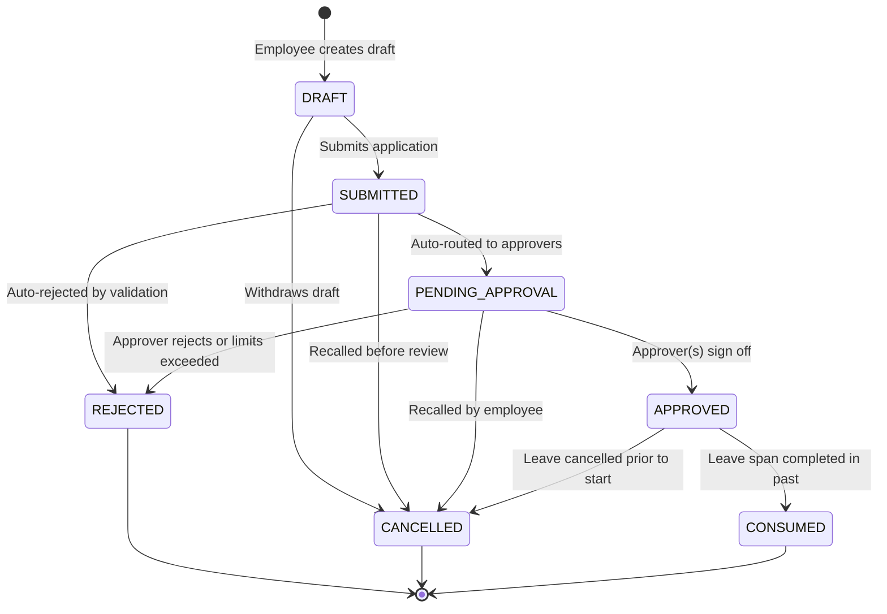
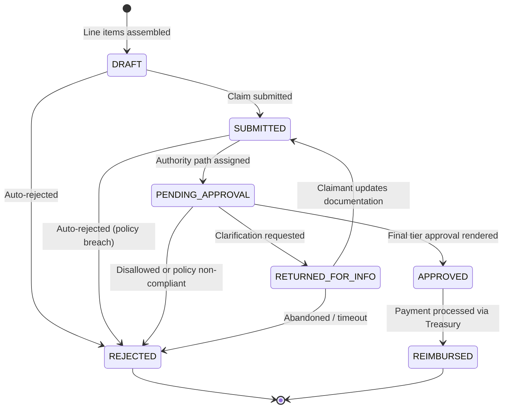
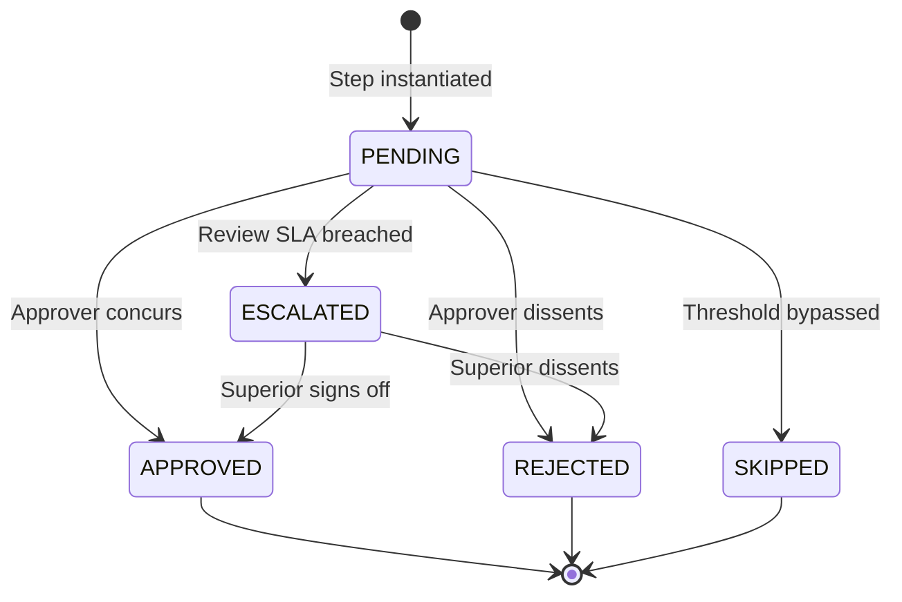

# Entity Relationship Diagram & Lifecycle Specifications

Comprehensive architectural specification of the YottaGen corporate leave and expense data model.

---

## 1. Mermaid Entity-Relationship Diagram (ERD)

```mermaid
erDiagram
    COST_CENTER ||--o{ EMPLOYEE : allocates_to
    EMPLOYEE ||--o{ EMPLOYEE : reports_to
    EMPLOYEE ||--o{ EMPLOYEE_COST_CENTER_ASSIGNMENT : historical_assignment
    COST_CENTER ||--o{ EMPLOYEE_COST_CENTER_ASSIGNMENT : maps_to
    EMPLOYEE ||--o{ LEAVE_BALANCE_LEDGER : posts_accrual_usage
    LEAVE_POLICY ||--o{ LEAVE_BALANCE_LEDGER : governs_postings
    EMPLOYEE ||--o{ LEAVE_BALANCE : materializes_snapshot
    LEAVE_POLICY ||--o{ LEAVE_BALANCE : defines_entitlement
    EMPLOYEE ||--o{ LEAVE_REQUEST : submits_application
    LEAVE_POLICY ||--o{ LEAVE_REQUEST : categorizes
    LEAVE_REQUEST ||--o{ LEAVE_REQUEST_EVENT : tracks_state_transitions
    EMPLOYEE ||--o{ LEAVE_REQUEST_EVENT : acts_as_transition_actor
    EXPENSE_POLICY ||--o{ EXPENSE_CLAIM : enforces_policy_terms
    EMPLOYEE ||--o{ EXPENSE_CLAIM : incurs_and_files
    COST_CENTER ||--o{ EXPENSE_CLAIM : charged_to
    EXPENSE_CLAIM ||--|{ EXPENSE_LINE : itemizes
    EXPENSE_CLAIM ||--o{ EXPENSE_CLAIM_EVENT : tracks_claim_transitions
    EMPLOYEE ||--o{ EXPENSE_CLAIM_EVENT : acts_as_claim_actor
    APPROVAL_RULE ||--o{ APPROVAL_RULE_CATEGORY : bridges_category
    APPROVAL_RULE ||--o{ APPROVAL_RULE_COUNTRY : bridges_country
    APPROVAL_RULE ||--o{ APPROVAL_STEP : establishes_step_criteria
    EMPLOYEE ||--o{ APPROVAL_STEP : executes_approval_step
    EXPENSE_CLAIM ||--o| REIMBURSEMENT : settles_payment
    EMPLOYEE ||--o{ REIMBURSEMENT : receives_disbursement

    COST_CENTER {
        string cost_center_id PK
        string code
        string name
        string department
        string manager_id FK
        string budget_currency
        float annual_budget
        string status
    }

    EMPLOYEE {
        string employee_id PK
        string first_name
        string last_name
        string email
        string country
        string city
        date hire_date
        date termination_date
        string status
        string employee_type
        int job_level
        string job_title
        string grade
        string manager_id FK
        string cost_center_id FK
        boolean is_finance_approver
        boolean is_hr_approver
        string role
    }

    HOLIDAY_CALENDAR {
        string holiday_id PK
        string country
        date holiday_date
        string holiday_name
        boolean is_half_day
    }

    LEAVE_POLICY {
        string policy_id PK
        string policy_name
        string description
        string country_scope
        float accrual_days_per_month
        float annual_cap
        float carry_forward_max
        int min_notice_days
        int max_consecutive_days
        int requires_doc_after_days
        boolean allows_negative_balance
        int approval_levels_by_duration
        date effective_from
        date effective_to
    }

    LEAVE_BALANCE_LEDGER {
        string ledger_id PK
        string employee_id FK
        string policy_id FK
        string entry_type
        float days
        date effective_date
        string reference_id
        timestamp created_at
        string notes
    }

    LEAVE_BALANCE {
        string balance_id PK
        string employee_id FK
        string policy_id FK
        date as_of_date
        float opening_balance
        float accrued_days
        float used_days
        float adjusted_days
        float pending_days
        float closing_balance
    }

    LEAVE_REQUEST {
        string request_id PK
        string employee_id FK
        string policy_id FK
        date start_date
        date end_date
        int calendar_days
        int business_days
        int weekend_days_in_span
        int holiday_days_in_span
        date submit_date
        string status
        string reason_code
        string comments
    }

    LEAVE_REQUEST_EVENT {
        string event_id PK
        string request_id FK
        string from_status
        string to_status
        string actor_id FK
        timestamp timestamp
        string reason_code
        string comment
    }

    EXPENSE_POLICY {
        string policy_id PK
        string policy_name
        string currency
        float daily_meal_limit
        float receipt_required_threshold
        float max_claim_amount
        float entertainment_per_person_limit
        float equipment_auto_approval_limit
        float lodging_daily_limit_in
        float lodging_daily_limit_de
        date effective_from
        date effective_to
    }

    EXPENSE_CLAIM {
        string claim_id PK
        string employee_id FK
        string cost_center_id FK
        string policy_id FK
        date claim_date
        date submit_date
        string purpose
        string currency
        float total_amount_local
        float total_amount_base
        string status
        int line_count
    }

    EXPENSE_LINE {
        string line_id PK
        string claim_id FK
        int line_number
        date expense_date
        string category
        string description
        float amount_local
        string currency
        float exchange_rate_to_base
        float amount_base
        string merchant_name
        string receipt_id
        string receipt_hash
        date receipt_date
        boolean has_receipt
        string file_name
        boolean is_disallowed
    }

    EXPENSE_CLAIM_EVENT {
        string event_id PK
        string claim_id FK
        string from_status
        string to_status
        string actor_id FK
        timestamp timestamp
        string reason_code
        string comment
    }

    APPROVAL_RULE {
        string rule_id PK
        string rule_code
        string name
        string entity_type
        float min_amount
        float max_amount
        int min_duration_days
        int max_duration_days
        string required_role
        int min_approver_level
        int step_number
        string description
    }

    APPROVAL_RULE_CATEGORY {
        string rule_category_id PK
        string rule_id FK
        string category
    }

    APPROVAL_RULE_COUNTRY {
        string rule_country_id PK
        string rule_id FK
        string country
    }

    APPROVAL_STEP {
        string step_id PK
        string request_id
        int step_number
        string rule_id FK
        string approver_id FK
        int level
        date due_date
        string status
        timestamp decided_at
        string decision
        string reason_code
        string comment
    }

    EMPLOYEE_COST_CENTER_ASSIGNMENT {
        string assignment_id PK
        string employee_id FK
        string cost_center_id FK
        float allocation_percentage
        date effective_from
        date effective_to
        boolean is_primary
    }

    DECISION_LOG {
        string decision_id PK
        string subject_id
        string decision
        string reason_code
        string reason_text
        string rule_id
        string inputs_snapshot_json
        timestamp timestamp
    }

    REIMBURSEMENT {
        string reimbursement_id PK
        string claim_id FK
        string employee_id FK
        string payment_method
        string currency
        float amount
        date payment_date
        string transaction_reference
        string status
    }
```

---

## 2. Cardinality Matrix

| Parent Table | Child Table | Foreign Key Field | Cardinality | Nullable / Optional | Temporal / Effective Dates | Relationship Semantics |
|---|---|---|---|---|---|---|
| `cost_center` | `employee` | `cost_center_id` | `1:N` | No | No | Primary department cost center allocation. |
| `employee` | `cost_center` | `manager_id` | `1:N` | No | No | Manager who owns cost center budget. |
| `employee` | `employee` | `manager_id` | `1:N` | Yes (CEO) | No | Strict supervisory hierarchy tree. |
| `employee` | `employee_cost_center_assignment` | `employee_id` | `1:N` | No | Yes (`effective_from`, `effective_to`) | Cost center assignment history over employee tenure. |
| `cost_center` | `employee_cost_center_assignment` | `cost_center_id` | `1:N` | No | Yes (`effective_from`, `effective_to`) | N:M assignment bridge with allocation weight. |
| `employee` | `leave_balance_ledger` | `employee_id` | `1:N` | No | No | Chronological postings of accrual and usage. |
| `leave_policy` | `leave_balance_ledger` | `policy_id` | `1:N` | No | No | Entitlement rate and cap governing posting. |
| `employee` | `leave_balance` | `employee_id` | `1:N` | No | No | Materialized point-in-time balance snapshot. |
| `leave_policy` | `leave_balance` | `policy_id` | `1:N` | No | No | Policy governing balance snapshot. |
| `employee` | `leave_request` | `employee_id` | `1:N` | No | No | Employee leave requests. |
| `leave_policy` | `leave_request` | `policy_id` | `1:N` | No | No | Specific policy requested. |
| `leave_request` | `leave_request_event` | `request_id` | `1:N` | No | No | Append-only state transition audit trail. |
| `employee` | `leave_request_event` | `actor_id` | `1:N` | No | No | Employee executing status transition. |
| `expense_policy` | `expense_claim` | `policy_id` | `1:N` | No | No | Governing corporate expense policy. |
| `employee` | `expense_claim` | `employee_id` | `1:N` | No | No | Submitting claimant. |
| `cost_center` | `expense_claim` | `cost_center_id` | `1:N` | Yes (Anomaly) | No | Chargeable cost center for line expenditures. |
| `expense_claim` | `expense_line` | `claim_id` | `1:N` (1-10) | No | No | Constituent itemized expense lines. |
| `expense_claim` | `expense_claim_event` | `claim_id` | `1:N` | No | No | Append-only claim transition audit history. |
| `employee` | `expense_claim_event` | `actor_id` | `1:N` | No | No | Reviewer or claimant performing action. |
| `approval_rule` | `approval_rule_category` | `rule_id` | `1:N` | No | No | N:M bridge to applicable expense categories. |
| `approval_rule` | `approval_rule_country` | `rule_id` | `1:N` | No | No | N:M bridge to applicable country jurisdictions. |
| `approval_rule` | `approval_step` | `rule_id` | `1:N` | No | No | Rule governing approval authority step. |
| `employee` | `approval_step` | `approver_id` | `1:N` | No | No | Assigned approver in reporting chain. |
| `expense_claim` | `reimbursement` | `claim_id` | `1:1` | Yes (Approved only) | No | Disbursement settlement for approved claims. |
| `employee` | `reimbursement` | `employee_id` | `1:N` | No | No | Beneficiary payee employee. |

---

## 3. Entity Lifecycle State Machines

### 3.1 Leave Request Lifecycle

### 3.2 Expense Claim Lifecycle

### 3.3 Approval Step Lifecycle

